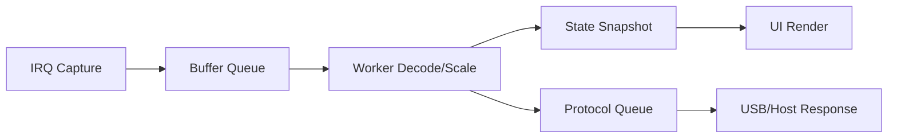

# 2D82 Reimplementation Guidance

Purpose: a concise, stable guidance document for the whole reimplementation.
This complements the full plan in `reimplementation-plan.md`.

---

## 1) Generic Rules (apply to all subsystems)

1. Clean-room behavior target
- Reproduce behavior, limits, and user-visible outcomes.
- Do not copy OEM code structure into the new implementation.

2. No legacy shims by default
- Do not keep old API shapes only for compatibility.
- Prefer one clear typed API per subsystem.

3. Hardware facts before abstraction
- Treat reverse-engineered facts as constraints.
- If a fact is uncertain, mark it explicit and avoid hard-coding assumptions.

4. Deterministic interfaces
- Use explicit units in APIs (`_mv`, `_ns`, `_hz`, `_pct`).
- Keep error reporting explicit (`0` success, negative errno on failure).

5. Non-blocking runtime paths
- IRQ paths and acquisition paths must avoid blocking work.
- Long operations belong in worker/thread context.

6. Testability is required
- Every subsystem change should have at least one direct validation path:
  - build check,
  - script/protocol check,
  - or emulator/hardware smoke test.

7. Documentation is part of the change
- When behavior or API changes, update docs in the same change.
- Keep rule docs stable; keep session-specific notes elsewhere.

8. Performance can change internals
- Internal implementation may differ completely from OEM if behavior remains correct.
- Prefer lower-latency, lower-copy, lower-jitter data paths when measurable.
- Keep compatibility at API/protocol boundaries, not at internal call graph level.

9. Zephyr-native first
- Prefer Zephyr subsystems and driver abstractions over custom bare-metal patterns.
- Use Zephyr primitives for concurrency and data flow (threads/workqueue/message queues) rather than ad-hoc global-state sequencing.
- Keep board/peripheral wiring in devicetree and Kconfig, not hidden in driver constants.

---

## 2) Subsystem Guidance Notes

### Scope and FPGA path
- Keep ADC sample representation explicit (offset-binary vs signed).
- Keep timebase, trigger, and channel scaling logic unit-safe and traceable.
- Preserve acquisition state machine semantics (run/single/stop/complete).
- SPI/register transactions can be redesigned for throughput.
- Prefer streaming-friendly readout paths (DMA/double-buffer/zero-copy where practical).
- Profile the capture pipeline end-to-end; optimize where the data actually stalls.

### DMM (CS7721)
- UART is transport for framed CS7721 data, not line-text protocol.
- Decode into typed reading/status; avoid scalar-only output APIs.
- Track frame/decode quality counters for diagnostics.

### AWG
- AWG implementation is deferred for the current phase unless explicitly requested.
- Separate waveform parameter model from transport writes.
- Enforce parameter bounds at API boundary (freq, amp, offset, duty).
- Keep start/stop behavior explicit and safe-by-default.

### USB protocol
- Preserve host-visible protocol compatibility for Phase 1.
- Validate packet shape/length/checking before state updates.
- Keep mode-switch side effects explicit and documented.
- Protocol compatibility does not require copying OEM internals.

### LCD and UI
- UI renders current instrument state; it does not own hardware truth.
- Keep screen transitions deterministic and key-map behavior consistent.
- Stub Phase 2 screens clearly; never break navigation.

### Keypad/input
- Debounce and repeat behavior must be deterministic and documented.
- Keep scan/dispatch separate from screen/business logic.

### Settings and calibration
- Runtime calibration application must be explicit and unit-safe.
- Persisted data layout must be versioned and validated on load.
- Unknown or invalid persisted data must fail safe.

### Emulator and bring-up scripts
- Scripts are helpers, not truth sources.
- Keep script paths/log paths in sync with repo structure.
- Build or emulation failures from stale paths should be fixed early.

---

## 3) Inspiration Policy (what to copy vs what to learn)

1. Copy behavior, not structure
- Match externally visible behavior (UI actions, USB responses, measurement semantics).
- Do not mirror function boundaries, naming patterns, or OEM sequencing unless required by hardware constraints.

2. Use references as constraints and ideas
- Reverse-engineered docs define what must be true at boundaries.
- Zephyr and subsystem docs provide implementation patterns for how to build it cleanly.

3. Performance-driven redesign is allowed
- SPI transaction model, buffering, and task split may be completely different if validated.
- Any redesign must include measurement evidence (latency, throughput, CPU load, dropped-frame rate).

4. Prefer explicit data-path architecture
- Define producer/consumer boundaries for acquisition, decode, and render.
- Minimize copies and lock contention on hot paths.
- Move formatting/presentation out of IRQ and capture-critical paths.

---

## 4) Zephyr Performance Architecture Template

Use this as the default structure for high-rate data paths (scope capture first).

1. Capture ISR (producer)
- Keep ISR work minimal: acknowledge hardware, enqueue metadata/pointer, exit.
- No formatting, no heavy parsing, no dynamic allocation.

2. Transport buffer layer
- Use a fixed-size ring or double-buffer strategy.
- Prefer ownership transfer by pointer/index over copying payload bytes.
- Track overrun/late-consumer counters.

3. Worker thread (processing stage)
- Consume queued buffers and run decode/scale/calibration transforms.
- Publish typed frames/readings to downstream queues.
- Use bounded queues and explicit backpressure policy (drop-oldest vs drop-newest).

4. UI/Protocol consumers
- UI reads latest stable snapshot; never blocks capture path.
- USB/host protocol consumes from a separate queue or snapshot interface.
- Presentation formatting happens here, not in ISR/capture-critical stages.

5. Synchronization rules
- ISR to worker: lock-free or short critical section only.
- Worker to UI/protocol: snapshot + versioning or message queue.
- Avoid coarse global locks across pipeline stages.

6. Suggested Zephyr primitives
- `k_msgq` for small fixed messages/events.
- `k_fifo` for pointer-based buffer ownership handoff.
- `k_work` / dedicated thread for deferred processing.
- `k_poll` for multiplexed event waits in worker/protocol tasks.

### Template Data Flow

### Performance Metrics (must record for redesigns)

1. End-to-end latency
- Capture IRQ timestamp to UI/protocol availability timestamp.

2. Throughput
- Effective samples/sec processed and published.

3. Data loss
- Queue overruns, dropped buffers, decode skips.

4. CPU budget
- ISR time, worker utilization, UI utilization.

5. Jitter
- Inter-frame timing variance at each stage boundary.

### Acceptance Targets (initial)

1. Zero dynamic allocation on steady-state hot path.
2. No blocking calls in ISR path.
3. No queue overrun under nominal operating mode.
4. Bounded worst-case latency documented for selected timebase.

---

## 5) Done Criteria for a Reimplementation Change

1. Compiles cleanly for target build profile.
2. API is typed and consistent with subsystem rules.
3. Hardware/protocol behavior matches documented constraints.
4. Validation path executed and recorded (build/test/script).
5. Relevant docs updated (plan or subsystem docs).

---

## 6) Reference Documents

- `vendors/hantek/2d82/docs/reimplementation-plan.md`
- `vendors/hantek/2d82/docs/fpga-replacement-design.md`
- `vendors/hantek/2d82/docs/hardware/dmm-cs7721.md`
- `vendors/hantek/2d82/docs/firmware/usb-protocol-design.md`
- `vendors/hantek/2d82/docs/hardware/usb-protocol.md`